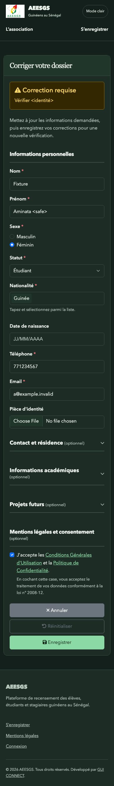
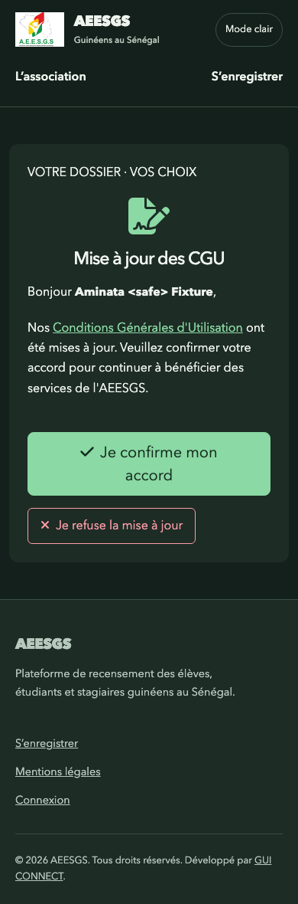
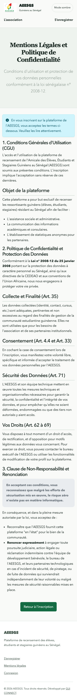

# Secure member correction and consent — 2026-10-24

Ticket 04 uses the shared public form shell for correction, consent and legal information. Existing URLs and token query strings remain unchanged. Legal copy and consent business actions are retained.

## Reproduce

- `./vendor/bin/phpunit`
- `python3 tests/http/tokens.py`
- `AMEA_BROWSER_CHECK=1 python3 tests/http/tokens.py`

The runner creates a disposable application/database/session copy, seeds synthetic records and uses `APP_ENV=test`; host database and SMTP credentials are not forwarded. Direct email delivery now respects the same existing environment suppression as template/async email. A PHPUnit regression with deliberately invalid transport addresses proves suppression happens before mailer setup; it failed before the guard and passed afterward. No real email is sent or externally qualified.

HTTP: 28 assertions cover correction token rendering and escaped notes, CSRF rejection, validation and retained data, valid resubmission and subsequent ineligible status, missing/random/revoked/deleted tokens, consent pending/accept/update/refuse/deletion-request states, escaped identity, CSRF, legal navigation, and unauthenticated private download denial. The initial valid correction GET exposed an existing missing `getAnneeArrivee()` method call; mapping now uses `Student::getArrivalYear()` and is exercised by the journey.

Chrome: 61 assertions cover correction, consent and legal pages at 1440px, 390px and 320px, both device themes, no document overflow, one main/H1, native required correction validation and keyboard focus, visible consent skip/action focus and keyboard submission, and invalid consent state. Reduced-motion preference is active throughout. Twelve screenshots are captured below; mobile consent dark, correction dark and legal light inspected visually. The final screenshots use the refreshed contrast patch.

## Boundaries

Review tokens have no elapsed-time TTL in the existing schema/repository. “Invalid or expired” is qualified here through absent/revoked/deleted/status-invalid records; no time-based expiry is claimed or introduced. Refusal/deletion request preserves existing behavior: request notification is acknowledged without deleting the record; real SMTP delivery is untested. HTTP uses loopback sessions and SQLite fixtures, so it does not qualify TLS cookies, MySQL, two-app isolation, deployment or persistence. Those remain later tickets.
